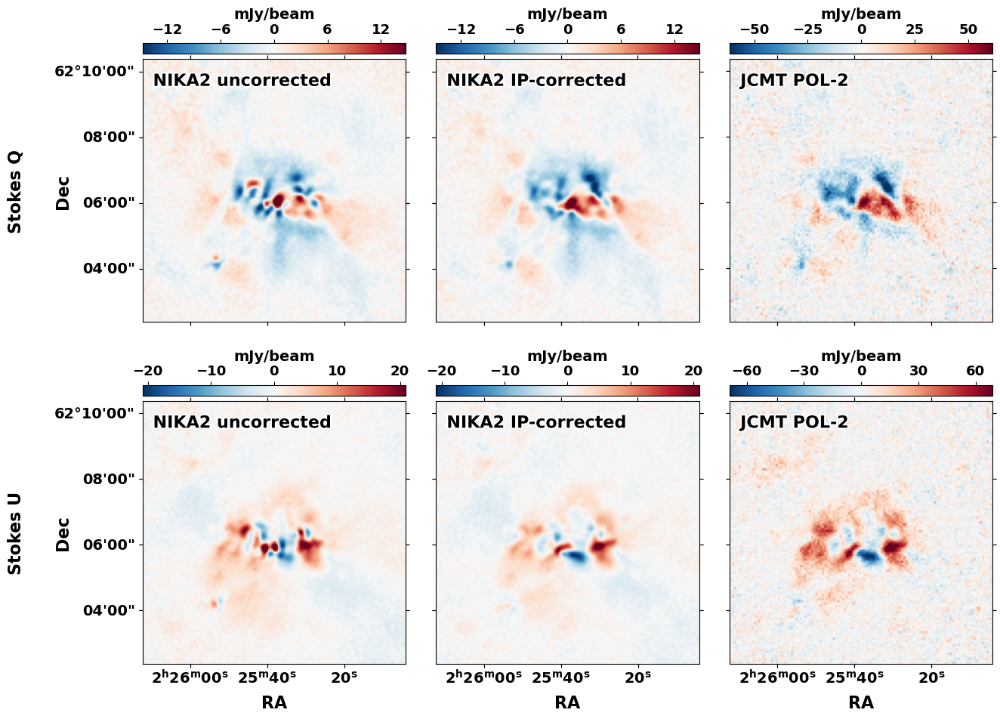
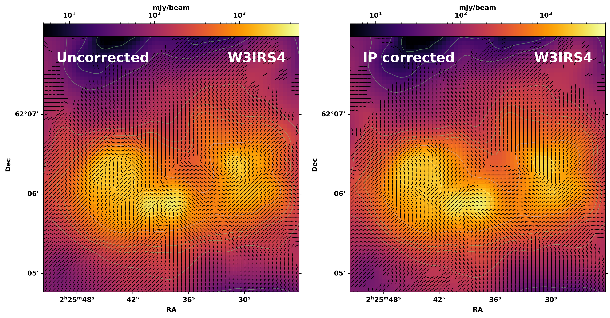

# Reduction of NIKA2pol observations

Welcome to the GitHub page outlining the data reduction pipeline used by the DYNAMAG large programme for the reduction of NIKA2 polarimetry data, including the correction of instrumental polarisation. Scripts are shared here to help others similarly reducing NIKA2pol data - if you use them please acknowledge this page and the associated paper when it comes out (Nonhebel et al. in prep)! While the scripts provided here are intended to be general, in places choices have been made specific to the dataset in question that may not be the best fit for all data.

The scripts provided here are a mix of Python and PIIC scripts. The Pointing and Imaging in Continuum (PIIC) software is the data reduction pipeline provided by IRAM. For information on PIIC, please see the very helpful handbook (https://www.iram.fr/~gildas/dist/piic.pdf), which outlines the installation and usage of PIIC. The pipeline introduced here makes use of many of the core PIIC scripts, with additional scripts to ease especially the process of correcting for instrumental polarisation. The main novelties are `source_ip_corr_MP.py` and `source_bootstrap_err.py` scripts, which make use of a database of calibration scans to correct for instrumental polarisation in an automised way. 

The pipeline is not perfect and likely improvements could be made - feel free to get in touch with suggestions or questions at manonhebel@mpia.de. 

## The importance of IP correction

Before we begin, a quick demonstration as to how important it is to take time to correct for the instrumental polarisation within NIKA2 observations. Below we plot a comparison between the NIKA2 observations of a region from the DYNAMAG sample before being corrected for IP, after correction using this pipeline, and observations from JCMT-POL2 (Kumar et al. 2025). 

The differences between the uncorrected and corrected maps are stark! In contrast, the corrected NIKA2 and JCMT-POL2 observations show great agreement. Correction for instrumental polarisation is therefore of utmost importance to your science and should be done with care. 

## Initial setup

To get started, first clone this repository with:

`git clone https://github.com/nonhebel/redNIKA2pol.git`

After cloning, the repo will have the following structure:

redNIKA2pol/
├── figures/
├── ip_db/
├── raw/
├── reductions/
│   └── <target>/
│       ├── 01_general/
│       ├── 02_individual/
│       ├── 03_corr/
│       ├── 04_bootstrap/
│       └── 05_products/
├── scripts/
│   ├── 01_general/
│   ├── 02_individual/
│   ├── 03_corr/
│   ├── 04_bootstrap/
│   └── 05_products/
├── README.md
├── requirements.txt
└── setup.sh

The repo is currently set up for the target W3IRS4 as an example (final .FITS files omitted as the data remains unpublished). To generate the same file tree for another target, open up the setup.sh script. Enter your target name and execute the script with `./setup.sh`. This will create the same structure as above for your given target, with the necessary scripts for each step of the pipeline where they need to be. Note all scripts should be executed within the directories in which they are found. Download the database of instrumental polarisation patterns from https://www.iram.fr/~berta/IP_corr_DB_202201_202608.tgz and place the scans in `ip_db/`. 

If you are starting completely from scratch and have not reduced your NIKA2 scans at all, place the raw science scans under `raw/`. If you have followed the PIIC tutorial to the point where you have produced individual Stokes cubes, symlink `red` in `reductions/<target>/01_general` to where the directoy of the original reduction, and `red` in `reductions/<target>/02_individual` to where the individually reduced science scans are stored. 

The `*.py` scripts used in the pipeline require a number of Python packages to be installed and have been tested using Python 3.12.4. One can replicate such a conda environment to remove the possibility of compatibility issues using:

`conda create -n redNIKA2pol_env python=3.12 --file requirements.txt`

The conda environment can then be activated using `conda activate redNIKA2pol_env`. If you do not have conda installed, check the `requirements.txt` file and install any missing packages with pip as usual. 

## Reducing your data

Now that everything is in the correct place, we can carry out the data reduction. This procedure is separated into 5 different steps, each with a separate directory in `reductions/<targets>`. As stated above, if you already have followed the PIIC tutorial and have individually reduced NIKA2 scans, you can skip the first two steps and proceed directly to the IP correction.

### 01_general

The first step in the reduction process follows the procedure outlined in detail in the PIIC handbook and uses the PIIC provided scripts. The aim is to produce a first science map of the target from the raw detector timelines, uncorrected for the effect of instrumental polarisation (IP). The reduction is an iterative process that works repeatedly to remove sky signal and instrument instabilities from the source signal. Here we makes use of the scripts set up for multi-core processing, `source_a13_MP.piic` and `source_setMPpar.piic`. A list of the scans to be reduced must be made, with the file name `source_a13.LIST`, which is then separated into multiple lists, one for each core (see PIIC handbook 5.2). Within the `source_a13_MP.piic` script, the source name, the number of procedures (cores to run on), and the number of iterations should be edited. Initially, set the number of iterations to 0. Within `source_setMPpar.piic`, the `smSNRpar` and `blOrderOrig` parameters are set. These will depend on the specifics of your target (see PIIC 3.2.6 and 4.14.4 to aid with your choice) - here we set `smSNRpar=0` and `blOrderOrig=4`. Also within `source_setMPpar.piic`, source and base range polygons can be set, as well as a zeroing radius (see PIIC 6.5.1 for information on how to define the polygons). For the initial zero-iteration reduction, leave the polygons commented out. With the scripts set up, run in batch mode using the command:

`nohup piic @ <target>_a13_MP.piic > <target>_a13_MP.log2 2>&1 &`

The output science map will give a first idea of the source structure, from which to define the source and base range polygons (`source.pol` and `base.pol`). The scripts should then be edited to run the reduction again, this time with the polygon definitions and with many iterations. The number of iterations needed for convergence will change with source. For the DYNAMAG reductions, around 50 iterations are needed. Convergence of the reductions can be checked using the `source_reduction_convergence.py` script, which produces plots of the changing flux and noise with increasing iterations (see e.g. `figures/W3IRS4_flux_convergence.pdf` and `figures/W3IRS4_rms_convergence.pdf`).

### 02_individual

The second step then produces reduced maps for each individual science scan, using the final source definition (`sbSource`) produced in 01_general (see PIIC 4.16). This is carried out using the script `source_a13_save_ind.piic`, where the parameter `wrIndMaps` has been set to yes. The reduction should be run with the same parameters as above, i.e. the same `smSNRpar` and `blOrderOrig`, as well as the same source and base range polygons, and zeroing radius. By saving individual maps, we can then individually correct them for IP which will vary from scan-to-scan. As above, run the script using:

`nohup piic @ <target>_a13_save_ind.piic > <targe>_a13_save_ind.log2> 2>&1 &`

### 03_corr

The third step aims to correct the individual maps produced in 02_individual for the contribution to Stokes Q and U from leakage from Stokes I. We call this instrumental polarisation, or IP. The tricky part about the IP present in NIKA2pol observations is that it is sensitive to observing conditions, including the elevation of the target, offset from optimal focus, and weather conditions. A blanket correction to all scans therefore cannot be made, and instead each scan must be corrected individually. 

One way to determine the IP present in observations is to observe an unpolarised target, i.e. a planet, where all polarised signal can be attributed to leakage from Stokes I. The standard NIKA2pol observing procedure aims to observe a planet before and after science observations, which can then be used to correct for the IP by deconvolving this signal from the science map. There are, however, a number of problems with this method. Often the elevation of the planet will differ from that of the science scan, leading to a poor characterisation of the IP pattern given the sensitivity of IP to elevation. Elevation differences > 10 degrees can lead to large residuals when the IP correction is performed, leading to artefacts in the final science maps (see the thesis of Hamza Ajeddig, https://theses.hal.science/tel-04078332). An even larger issue, however, is when there are no planets available at all to observe at the time observations. In this case, calibration measurements are instead taken on QSOs, which have a time-varying degree of polarisation and therefore need additional calibrator measurements to remove the intrinsic polarisation of the QSO. This is undesirable, with the errors quickly compounding as we introduce another calibration step where we again might be at a different elevation / focus. 

Here we don't limit ourselves to calibration measurements taken before and after the science scans, and instead match each science scan to an appropriate planet calibration scan via different means. This is carried out by the `source_ip_corr_MP.py`. This script is automised, so there is no need to scroll through tapas to find the necessary calibration scans, and should be ready to run after setting a few key parameters. 

#### source_ip_corr_MP.py

The aim of `source_ip_corr_MP.py` is to correct each science scan with the 'best' calibrator scan from a catalogue of such scans (scans placed in `ip_db`). This catalogue contains all available planet calibration scans (polarised calib_1scans) taken during the NIKA2pol observing campaign to date, covering a large range of observing conditions and thus IP patterns. 

`source_ip_corr_MP.py` works by finding candidate calibration scans from the catalogue of scans, for each science scan. It does this by filtering by elevation, selecting only calibrators that are within a user-set `ELEV_DIFF` from the science target, which here we set to 10 degrees. It then finds which calibrator produces the 'best' IP correction for each science scan and produces the final IP corrected science map. It does this through a number of stages:

##### Stage 1) - CORRECT 

Each science scan is corrected for IP with every identified candidate calibrator using `corr_instr_pol_1scan.piic`. `corr_instr_pol_1scan.piic` corrects for the IP of the science scan via deconvolving the candidate calibrator signal from the science signal, with appropriate scaling by the Stokes I component (see PIIC 6.9). The procedure is carried out for both array 1 and array 3 individually - it is important that this is the case due to focus offsets between the arrays, leading to different IP patterns. The user should consider which `TAPER_RADII` values to use, which can be set at the top-line configuration of the `source_ip_corr_MP.py` script. The inner and outer radius control the region over which to taper the science signal, in order to avoid spurious results due to edge effects when maps are Fourier transformed as part of the correction. More information on this can be found in PIIC 6.9.

##### Stage 2) - SELECT

The 'best' calibrator is selected for each science scan. Unlike matching the elevation of the science and calibration measurements, matching the remaining conditions which may influence the IP (e.g. the offset from the optimal focus at the time of observations, variations in the temperature of the telescope etc.) is non-trivial. Instead, the best calibrator is decided *a posteriori*, via a `METRIC` calculated for the IP-corrected science maps created using each candidate calibrator. The suggested metric is the standard deviation (`stdv`) across the inner region of the corrected science map. The reasoning behind this is that the IP signal in Stokes Q and U is known to be cloverleaf pattern with positive and negative lobes, and thus the better the IP correction, the lower the standard deviation should be. The central region of the map is focussed on such that noise at the map-edges doesn't have an impact, through setting the `CROP_FRAC`. Moreover, the IP scales with Stokes I, and the centre of the map, where the bright Stokes I source is assumed to be present, will be most affected by the IP correction. 

The metric is calculated for each candidate calibrator, with the best calibrator that which minimises it. To flag scans that many have been poorly corrected for IP, `RESIDUAL_THRESHOLD` can be set, in units of % of maximum Stokes I. For example, here we set the threshold to 5, as within the DYNAMAG sample, we do not expect polarisation fractions greater than 5%. For scans with residuals greater than the set threshold, a warning is printed. They are, however, not removed from the LIST produced in the WRITE_LISTS stage - inspect the flagged maps and remove them by hand if need be.

If `SAVE_FIGURES = True`, then a figure showing Stokes Q / U of each science scan before and after correction with the best calibrator is produced. Flagged scans are highlighted by a red border in this diagnostic figure. 

##### Stage 3)- REFINE

An *optional* additional step to attempt to improve the correction further is to refine the calibrator selection by reducing the 'stack' standard deviation. The idea behind this step is that the best calibrators should lead to the lowest standard deviation *between* IP-corrected maps - as while the IP signal will vary from scan-to-scan, the true science signal will not, beyond the usual noise. To minimise the 'stack' standard deviation - the pixel-wise standard deviation of Q and U maps normalised by I in arrays 1 and 3 across all scans - a coordinate descent optimisation is performed: Starting from the initial best calibrator assignments from Stage 2), for each science scan, each candidate calibrator is trialled in turn, while holding the remainder of the corrected science maps the same. The best calibrator is updated if the stack standard deviation decreases. This procedure is performed iteratively until the standard deviation no longer decreases, i.e. convergence has been achieved. 

*Interaction with the residual threshold.* Scans flagged as bad in the SELECT stage are excluded from the stack standard deviation, so that a scan the
correction has failed on does not drive the choice of calibrator for the
others. Their calibrator assignment is also left unchanged: REFINE never
reassigns a flagged scan. They remain flagged and are still included in the
final map unless you remove them (see Stage 2).

If `SAVE_FIGURES = True`, then once again a figure showing Stokes Q / U of each science scan before and after correction with the now updated best calibrator is produced. If the calibrator has changed from that chosen in the previous SELECT stage, the row is highlighted in orange. Comparing this figure to that produced by SELECT, the variation between the science scans should be lower. *However*, whether this really leads to a 'better' IP correction is not guaranteed - just because the scans are now consistent, does not mean that are consistently correct. From testing, the optional REFINE step tends to swap a large amount of the best calibrators, with the resulting corrected scans indeed more similar, but often with suspiciously strong polarisation and patterns reminiscent of IP. Conclusion: use with caution and check the diagnostic plots.

##### Stage 4) - WRITE_LISTS

The best corrected maps are written to `all_corr_maps.LIST` and the associated RGW weights maps are written to `all_rgw.LIST`.

##### Stage 5) - COMBINE

`combine_maps.piic` is used to co-add the corrected maps, weighted appropriately by the corresponding rgw maps, to produce a final IP-corrected science map of the target, under `red/<target>_IP_corrected.fits`.

#### Running the script

Having edited the necessary parameters at the top of the `source_ip_corr_MP.py` script, the script can be run with `python <target>_ip_corr_MP.py`. Depending on how liberal you are with the elevation threshold and conservative with the number of cores used, the correction procedure may take a considerable amount of time. The script can be stopped, however, and will resume from where it left off. Additionally, if you have many candidate calibrators, it may be desirable to run the script in batch mode, with `nohup python <target>_ip_corr_MP.py > log_<target>_ip_corr_MP.log2 2>&1 &`.

#### A note about paths and unbalanced quote counts

The path length that can be parsed by PIIC/GILDAS is finite, which can lead to 'unbalanced quote count' errors if your path lengths become too long. If you run into this issue using the above code - which is likely given the nested directories and long file names - the easy solution is to have a symlink from your home directory to the repo directory where the reduction is taking place. E.g. if your repo path is something along the lines of `some/long/path/to/your/repo_directory`, produce a symlink to the repo directory from your home directory, such that the path PIIC/GILDAS now sees is `~/repo_directory`. You can then manually set the `REPO_ROOT` in `source_ip_corr_MP.py` to `REPO_ROOT = Path.home()/"redNIKA2pol"` and this should avoid triggering path length errors. 

### 04_bootstrap

The fourth step aims to estimate the uncertainty in Stokes Q and U, taking into account additional uncertainty introduced by imperfect IP correction. This is done by bootstrapping over the final IP-corrected individual scans, using the `source_bootstrap_err.py` script. Bootstrapping is a means of estimating statistics of a dataset via randomly sampling the dataset with replacement: `source_bootstrap_err.py` performs `N_BOOTSTRAP` iterations, each randomly sampling with replacement from the list of corrected scans produced in the 03_corr step and combining the sampled set of maps using `combine_maps.piic`. The per-pixel 3x3 covariance matrix over Stokes I, Q and U is then calculated over the full set of bootstrap realisations. As noted above, a 'better' IP correction will lead to reduced variation in the Stokes Q and U signal between scans, tending to the limit of simply the noise in the case IP has perfectly been removed / is not present. The covariance matrix at each point in the map therefore gives us an idea of additional error, in excess of the typical RMS noise, due to residual signal from the IP.

`source_bootstrap_err.py` can produce bootstrapped covariance maps at the native map resolution or for spatially smoothed maps. `bsm.piic` applies a BSM x BSM pixel box average to the original cube, producing smooth maps with pixels BSM x BSM times larger than in the original (see PIIC 6.8). Setting `BSM` > 1 leads to the pipeline first smoothing each individual scan before bootstrapping over the smoothed scans. Using a `BSM` > 1 may be desirable in cases of low signal-to-noise and also for plotting, where one does not want to visualise all polarisation vectors. Note that one cannot simply smooth the resulting `BSM` = 1 noise map, but rather should carry out the bootstrapping for each desired `BSM` value, as the standard deviation of an average and the average of a standard deviation are not the same. 

The remaining parameters to set are `N_CORES`, as the script is parallelised, and `N_BOOTSTRAP`. `N_BOOTSTRAP` should be chosen such that the error estimate converge; to test this, use the script `source_bootstrap_convergence.py`, which will show the calculated standard deviation at a pixel over an increased number of bootstrap realisations. 

### 05_products

The final step produces science-ready data products. `source_create_products.py` symlinks the uncorrected and IP-corrected maps, along with the associated RGW map and the Stokes I, Q, U RMS polygons output by PIIC, into the 05_products directory for easy access. As in 04_bootstrap, the desired `BSM` value can be set. Associated noise maps of both the uncorrected and IP-corrected maps are produced using the script `creaRMS_IQU.piic`, which uses the RGW weight map to rescale the RMS measured within the RMS polygons, giving us insight into how the noise varies across the science map rather than using a single value (see PIIC 3.4.4). In the case of the IP_corrected map, the noise maps for Stokes Q and U are replaced by the bootstrap-derived standard deviations, from 04_bootstrap. If we now compare the noise maps for the uncorrected and IP-corrected cases, we should now see that in the case of the outer regions of the map, where the Stokes I emission is weak and therefore leakage is negligible, the two agree closely. Towards the centre, however, the bootstrap uncertainty in Stokes Q and U exceeds the PIIC noise estimate, reflecting the additional uncertainty introduced by the imperfect IP correction and giving a more conservative and physically-motivated noise estimate in regions of significant IP. 

To compare the final uncorrected and IP-corrected maps and see the fruits of your labour, the `source_uncorrected_v_corrected.py` can be used. The script produces plots of the Stokes I emission overlaid with the magnetic field vectors (polarisation vectors rotated by 90 degrees) of a chosen level of significance. How different the uncorrected and corrected results are will be heavily dependent on the source: As mentioned previously, the IP in the case of NIKA2pol is a leakage from Stokes I to Stokes Q and U. It will therefore be most dominant in regions of bright Stokes I emission. The extent of the emission, however, is also important. Where you have extended emission, the leakage pattern with its positive and negative lobes at least partially cancels out, and the IP appears less strongly than in the case of a point source or a region with a bright central object. This effect is also noticeable in the smoothed version of the maps. With increasing `BSM` value, the IP pattern is smoothed out and the difference between the uncorrected and corrected maps decreases. 

Below is again an example from the DYNAMAG sample, showcasing the result from `source_uncorrected_v_corrected.py` (Nonhebel et al. in prep). While the vectors are unchanged in the diffuse regions, at the intensity peaks clear differences are apparent in the inferred direction of the magnetic field. Once more, this highlights the importance of correcting for IP!

Good luck on your quest for leakage-free maps.

 

